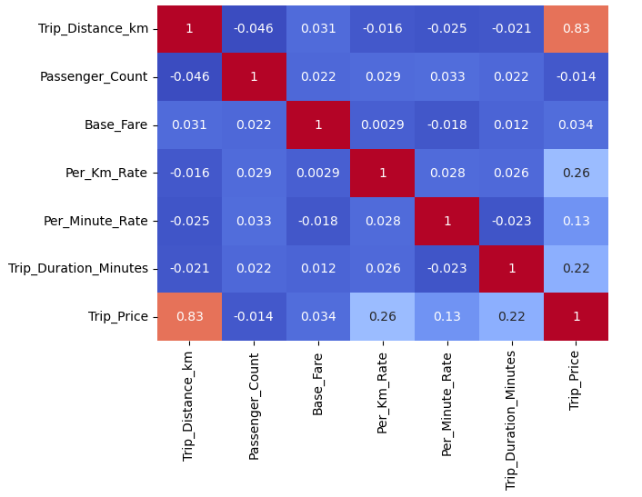
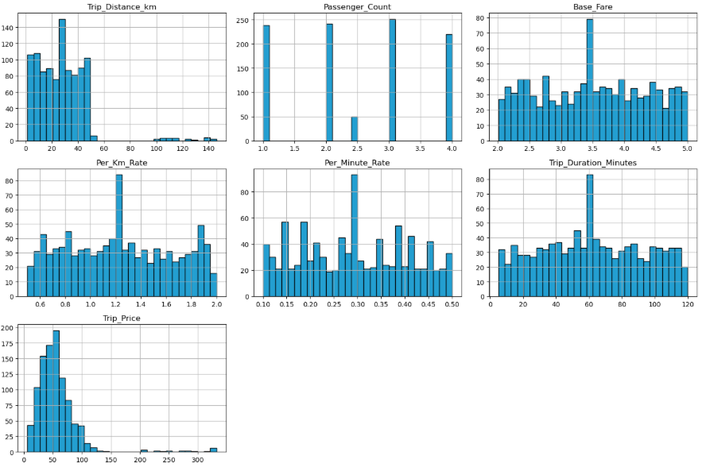
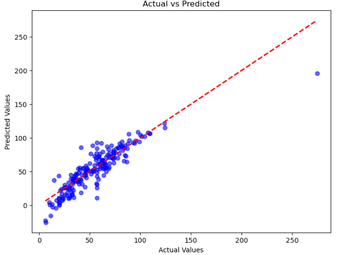

# Taxi Fare Prediction Using Machine Learning

## Project Overview

This project develops a machine learning model to estimate the fare of a taxi journey based on trip characteristics. A **Linear Regression** model is used to learn the relationship between the final trip price and factors such as travel distance, trip duration, traffic conditions, weather, passenger count, and pricing rates.

The goal is to build a regression model capable of producing reliable fare estimates from historical taxi trip information.

---

## Dataset

The dataset consists of trip-level information and pricing attributes that influence the final taxi fare.

| Feature | Description |
|---------|-------------|
| **Trip_Distance_km** | Distance covered during the journey, measured in kilometers. |
| **Time_of_Day** | Period during which the trip took place, such as morning, afternoon, evening, or night. |
| **Day_of_Week** | Specifies whether the journey occurred on a weekday or weekend. |
| **Passenger_Count** | Number of passengers traveling in the taxi. |
| **Traffic_Conditions** | Traffic level during the journey, categorized as Low, Medium, or High. |
| **Weather** | Weather conditions observed during the trip. |
| **Base_Fare** | Fixed starting charge applied to the trip. |
| **Per_Km_Rate** | Fare charged for every kilometer traveled. |
| **Per_Minute_Rate** | Fare charged according to the duration of the journey. |
| **Trip_Duration_Minutes** | Total time taken to complete the trip. |
| **Trip_Price** | Total fare paid for the journey and the prediction target. |

---

## Project Pipeline

### 1. Exploratory Data Analysis

The dataset was first analyzed to understand the distribution of the variables and relationships between different features.

The following visualizations were generated:

- **Correlation Matrix:** Examines relationships between numerical variables.
- **Data Visualization:** Provides graphical insights into the characteristics and patterns present in the dataset.

**Correlation Matrix**



**Data Visualization**



---

### 2. Data Preparation

Before training the regression model, the dataset was processed through several steps:

- Loaded and inspected the raw dataset.
- Identified and handled missing or invalid records.
- Converted categorical variables into numerical representations.
- Prepared numerical features for model training.
- Applied feature scaling where necessary.
- Divided the data into training and testing sets.

---

### 3. Model Training

A **Linear Regression** model was trained using the processed trip data.

The model learns how different factors, such as distance, duration, traffic, and fare rates, contribute to the overall taxi fare. After training, the model was used to generate fare predictions for previously unseen test data.

---

### 4. Model Evaluation

The model's performance was evaluated using regression metrics:

- **Mean Squared Error (MSE):** Measures the average squared difference between actual and predicted fares.
- **R² Score:** Indicates how well the model explains the variation in the target variable.

A visualization comparing the actual taxi fares with the model's predicted values was also generated.

**Actual vs Predicted Prices**



---

## Results

The trained Linear Regression model achieved the following performance:

| Evaluation Metric | Result |
|--------------------|--------|
| **Mean Squared Error (MSE)** | 194.72 |
| **R² Score** | 0.765 |

An **R² score of 0.765** indicates that the model explains approximately **76.5% of the variation in taxi trip prices** within the evaluated dataset.

---

## Installation and Usage

### 1. Clone the Repository

```bash
git clone https://github.com/AShr12xz/Taxi-Price-Prediction.git
cd Taxi-Price-Prediction
```

### 2. Install Dependencies

Install the required Python libraries using:

```bash
pip install pandas numpy scikit-learn matplotlib seaborn
```

### 3. Run the Notebook

Launch the Jupyter Notebook and execute:

```text
Taxi_Price_Prediction.ipynb
```

---

## Technologies Used

| Category | Technologies |
|----------|--------------|
| **Programming Language** | Python 3.8+ |
| **Data Processing** | pandas, NumPy |
| **Data Visualization** | Matplotlib, Seaborn |
| **Machine Learning** | Scikit-learn |
| **Development Environment** | Jupyter Notebook |

---

## Project Structure

```text
Taxi-Price-Prediction/
│
├── Taxi_Price_Prediction.ipynb
├── outputs/
│   ├── correlation_matrix.png
│   ├── data_visualization.png
│   └── prediction.png
│
└── README.md
```

---

## Key Takeaway

The project demonstrates how supervised machine learning can be applied to **taxi fare estimation** using historical trip information. By combining trip distance, duration, pricing parameters, traffic, weather, and other attributes, the Linear Regression model provides a data-driven estimate of the expected journey cost.